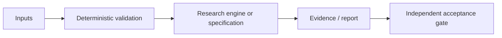

# Computing Topology V4: научно-техническое досье V5

**Дата ревизии:** 24.10.2026. **Доказательный статус:** VALIDATION EVIDENCE PRESENT. **Репозиторий:** [Shtenco/synergy_computing_topology](https://github.com/Shtenco/synergy_computing_topology).

> Документационная оценка фактически обнаруженных файлов main. Не является отчётом о свежем запуске CI, независимом benchmark, готовности производства или научным доказательством результата.

## Исследовательская проблема и проектная цель

Компактный индекс, ускорение повторных запросов, корректность байтов.

## Математическое ядро

\[S_{e2e}(Q)=\frac{T_{baseline}(Q)}{T_{build\_index}+T_{optimized}(Q)}.\]

Математическая запись отделяет модель от операционно подтверждённого результата. Любые заявленные преимущества должны быть перепроверены на сопоставимых baseline и зафиксированных входных данных.

## Архитектурная карта

Это концептуальный поток: стрелки не обозначают уже развернутую связь с другими сервисами.

## Артефакты исходного дерева

- [`src/v4/v4_correctness_harness.py`](../src/v4/v4_correctness_harness.py)
- [`validation/V4_GATE_RESULTS.json`](../validation/V4_GATE_RESULTS.json)
- [`docs/SHTENCO_V4_VALIDATION_REPORT_2026-09-30.md`](../docs/SHTENCO_V4_VALIDATION_REPORT_2026-09-30.md)

## Критерии приемки и фальсификация

Проверять end-to-end включая стоимость построения индекса, SHA256, ASAN/UBSAN и matching query sets.

Обязательные поля для подтверждённого результата: commit SHA, environment, invocation, dataset manifest, raw measurements, baseline, uncertainty, adversarial/negative controls и точная область действия утверждения.

## Ограничения и угрозы

Результат >1000× относится к конкретному режиму повторных запросов; runtime загрузка kernel V4 на текущем хосте не подтверждена.

Нельзя превращать архитектурную идею, гипотезу, simulated return либо workflow definition в статус DEPLOYED или GREEN без наблюдаемого и проверяемого evidence.

## Следующая итерация

1. Привязать каждый claim к конкретному source/тесту/артефакту.
2. Описать один negative control и минимальный воспроизводимый acceptance-gate.
3. Зафиксировать честный maturity level, а не расширять рекламные формулировки.
4. Сохранять прежние README, историю и исследовательские исходники.

**Эталоны оформления:** [REVERSE-EXP](https://github.com/Shtenco/dlp_solver), [SYNERGY SYSTEM](https://github.com/Shtenco/synergy_system).
